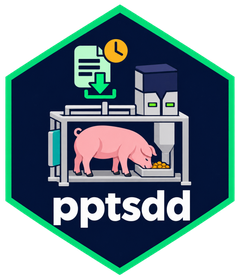

# pptsdd <a href="https://tony2015116.github.io/pptsdd/"></a>

<!-- badges: start -->
[](DESCRIPTION)
[](https://github.com/tony2015116/pptsdd/commits/master/)
<!-- badges: end -->

**pptsdd**（Pig Performance Test Station Data Download）是一个 R 包，用于从 Nedap 生猪性能测定站下载 CSV。可以按站点和日期范围导出，也可以将每个站点每天的数据分别保存，并在 Windows 上定时下载前一天的报表。

| 需求 | 函数 | 下载方式 |
| --- | --- | --- |
| 合并导出一段站点范围和日期范围的数据 | `get_csv()` | HTTP |
| 每个站点、每天分别保存一份 CSV | `get_csv_auto()` | HTTP |
| 通过网页菜单选择 CSV 报表 | `download_csv_auto()` | Chrome 或 Edge |
| 每天在指定时间下载前一天的数据 | `get_csv_schedule()` / `download_csv_schedule()` | Windows 任务计划程序 |

能用 HTTP 取得所需报表时，从 `get_csv()` 或 `get_csv_auto()` 开始。需要通过网页菜单选择报表时，使用 Chrome 或 Edge。

## 一、安装

当前版本的安装环境为 **Windows 和 R 4.1.0 或更高版本**。包依赖 Windows 专用的 `taskscheduleR`，所以即使只用 HTTP 下载，安装时也需要该依赖。Chrome 下载需要 Google Chrome 和可从系统 PATH 调用的 Java。Edge 下载需要 Microsoft Edge 和支持 Edge 的新版 `wdauto`。

```r
install.packages("pak")
pak::pkg_install("tony2015116/wdauto")
pak::pkg_install("tony2015116/pptsdd")
```

## 二、配置测定站账号

运行 `file.edit(path.expand("~/.Renviron"))`，把下面三行填入当前账户的 `.Renviron`，将示例值换成你的实际信息。网址填写测定站根地址即可。

```text
NEDAP_URL=https://your-site.vpu-online.cn
NEDAP_USERNAME=your_username
NEDAP_PASSWORD="your_password"
```

保存后重启 R。以下变量和输出目录供后面的示例共用。第一次试跑时，请把第 3 节示例中的站点编号和日期换成有数据的实际值。

```r
library(pptsdd)

url <- Sys.getenv("NEDAP_URL")
username <- Sys.getenv("NEDAP_USERNAME")
password <- Sys.getenv("NEDAP_PASSWORD")
download_path <- file.path(path.expand("~"), "pptsdd-data")

stopifnot(all(nzchar(c(url, username, password))))
```

## 三、直接下载 CSV

### 按范围导出一份 CSV

下面向测定站请求站点 `606` 至 `608`、2024 年 2 月 18 日至 19 日的报表。结果直接保存到 `download_path`。

```r
get_csv(
  url = url, username = username, password = password,
  location_min = "606", location_max = "608",
  date_min = "2024-02-18", date_max = "2024-02-19",
  download_path = download_path,
  show_message = TRUE
)
```

### 按站点和日期逐份下载

下面请求两个站点、两个日期，共四份报表。站点编号用字符串表示，日期支持 `Date` 和 `YYYY-MM-DD` 字符串。

```r
get_csv_auto(
  url = url, username = username, password = password,
  location = c("606", "608"),
  date = seq(as.Date("2024-02-18"), as.Date("2024-02-19"), by = "day"),
  download_path = download_path,
  show_message = TRUE
)
```

## 四、使用 Chrome 或 Edge 下载

先启动所选浏览器的 WebDriver，再通过 `csv_position` 指定 CSV 报表在网页列表中的位置。示例使用第 1 项，请根据实际页面调整。

```r
driver_dir <- "C:/pptsdd-webdriver"
dir.create(driver_dir, recursive = TRUE, showWarnings = FALSE)
connect_to_browser(dest_dir = driver_dir)

download_csv_auto(
  url = url, username = username, password = password,
  csv_position = "1",
  location = c("606", "608"),
  date = "2024-02-18",
  download_path = download_path
)
```

使用 Edge 时，在两个函数中都指定 `browser = "edge"`：

```r
connect_to_browser(dest_dir = driver_dir, browser = "edge")

download_csv_auto(
  url = url, username = username, password = password,
  csv_position = "1",
  location = c("606", "608"),
  date = "2024-02-18",
  download_path = download_path,
  browser = "edge"
)
```

Chrome 和 Edge 使用各自的本机服务。下载函数会关闭本次浏览器会话。需要停止服务时，使用 `disconnect_from_browser(browser = "edge")` 停止 Edge，或使用 `disconnect_from_browser()` 停止 Chrome。

## 五、设置每日定时下载

下面创建名为 `nedap_csv_daily` 的任务，从明天开始，每天 20:00 以电脑本地时间下载前一天的数据。请按 Windows 地区设置填写 `startdate`，示例采用年/月/日。

```r
task_args <- list(
  url = url,
  username = username,
  password_env = "NEDAP_PASSWORD",
  location = c("606", "608"),
  download_path = download_path
)

get_csv_schedule(
  taskname = "nedap_csv_daily",
  schedule = "DAILY",
  starttime = "20:00",
  startdate = format(Sys.Date() + 1L, "%Y/%m/%d"),
  rscript_args = task_args
)
```

若需通过浏览器定时下载，改用 `download_csv_schedule()`，并将参数列表设为 `c(task_args, list(csv_position = "1"))`。使用 Edge 时，将列表设为 `c(task_args, list(csv_position = "1", browser = "edge"))`。任务运行时，所选浏览器的 WebDriver 服务需要已启动。

- **密码**由任务执行账户在运行时读取。`password_env` 填变量名。可在该账户的 `.Renviron` 中配置，或为该账户设置 Windows 环境变量。
- **验证**可在 Windows 任务计划程序里手动运行一次，查看输出目录和 `C:/Temp/pptsdd/` 下对应的 `.log` 文件。
- **删除任务**可运行 `taskscheduleR::taskscheduler_delete("nedap_csv_daily")`。

### 迁移旧版定时任务

先为任务执行账户配置密码变量，再创建新版任务。若需沿用原任务名，先删除同名旧任务。确认新版任务成功运行后，清理旧脚本和 `C:/Temp/config_<任务名>.txt`，旧配置可能包含明文密码。

## 六、查看结果与排查问题

批量下载会在 `download_path` 下按站点归档。`NonEmptyCSVs/<站点>/` 存放有数据行的 CSV，`EmptyCSVs/<站点>/` 存放只有表头的 CSV。文件名包含报表日期和下载日期，例如 `location606_2024-02-18data_2024-02-20download.csv`。

| 现象 | 检查项 |
| --- | --- |
| 登录失败或返回非 CSV 报表 | 确认站点根地址、账号和报表权限。可先在浏览器中登录并手动导出同一份报表。 |
| CSV 被归到 `EmptyCSVs` | 检查对应站点和日期在 Nedap 网页中是否有数据。 |
| 浏览器下载超时 | 检查所选浏览器、对应的 WebDriver 服务，以及 `csv_position` 对应的报表。 |
| 手动下载成功，定时任务失败 | 检查任务执行账户能否读取密码变量、写入输出目录，并查看任务日志。 |

[函数参考](https://tony2015116.github.io/pptsdd/reference/) · [更新记录](NEWS.md) · [许可证](LICENSE.md) · [反馈问题](https://github.com/tony2015116/pptsdd/issues)
